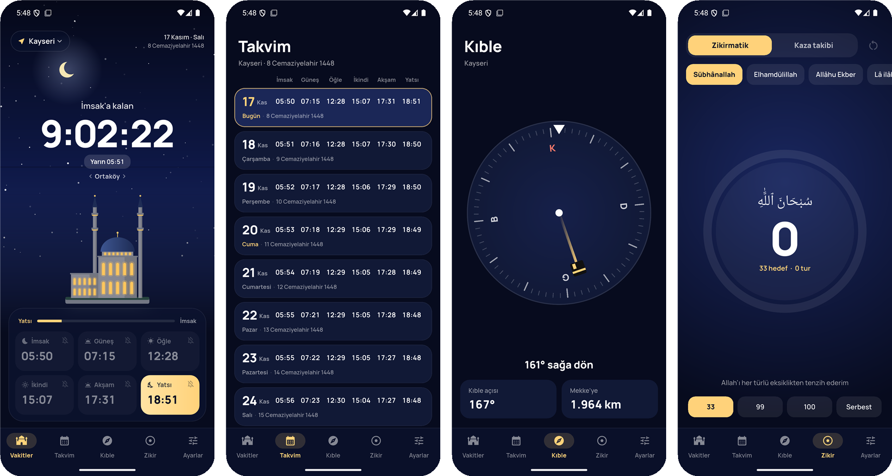

# Vakit

Namaz vakitleri, ana ekran widget'ları, kıble pusulası, takvim, zikirmatik ve kaza takibi. Android için Flutter uygulaması.



## İndir

APK: [dervisaraslan1.github.io/indirmeler](https://dervisaraslan1.github.io/indirmeler/). Mağazada değil, elden kurulur.

## Özellikler

- **Vakitler:** Diyanet İşleri Başkanlığı'nın ilçe bazındaki tablosu, 30 gün cihazda saklanır. İnternet yokken Diyanet yöntemiyle cihazda hesaplanır (en fazla 1 dk fark).
- **Konum:** il ve ilçe konumdan bulunur; elle de seçilebilir.
- **Widget'lar:** 4×2, 4×1, 2×2, 2×1, 1×1. Seçilen cami ve gece/gündüz teması widget'lara da yansır.
- **Bildirimler:** vakitten önce hatırlatma ve vakit girince bildirim. Vakit sesi seçilebilir (telefonun sesleri ya da bir ezan dosyası).
- **Ramazan modu:** Ramazan'da "İftara kalan / Sahura kalan" ve iftar bildirimi.
- **Kıble pusulası, 30 günlük takvim (hicri tarih ve dini günler), zikirmatik, kaza takibi.**

## Yapı

- `lib/`: Flutter arayüzü.
- `android/app/src/main/kotlin/dev/vakit/widget/`: widget'lar, vakit verisi, bildirim alarmları, konum ve pusula. Bunlar uygulama kapalıyken de çalışmak zorunda olduğu için yereldir; arayüz bunlara `vakit/native` kanalından ulaşır.
- Vakit verisi: `ezanvakti.emushaf.net` (Diyanet verisini sunan ücretsiz servis). Servis yanıt vermezse `PrayerTimes.kt` içindeki formül kullanılır.

## Derleme

```
flutter build apk --release --target-platform android-arm,android-arm64
```

## İmzalama

Yayın anahtarı repoda durmaz: `C:/Users/Omega/.vakit-imza/vakit-release.jks`, şifresi aynı klasördeki `key.properties` içinde. Derleme `android/key.properties` dosyasını okur (git'e girmez). Dosya yoksa release derlemesi **imzasız** kalır.

Anahtar kaybolursa telefondaki uygulama bir daha güncellenemez; kullanıcıların silip baştan kurması gerekir. Klasörün yedeğini sakla.

## Lisans

MIT. Ayrıntılar [LICENSE](LICENSE) dosyasında.
